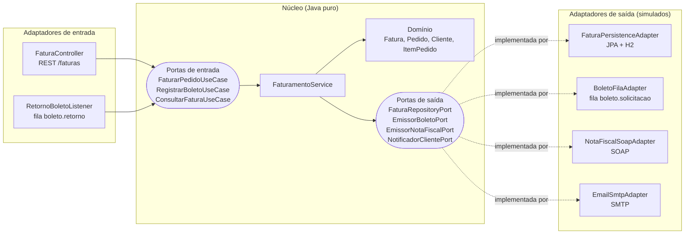
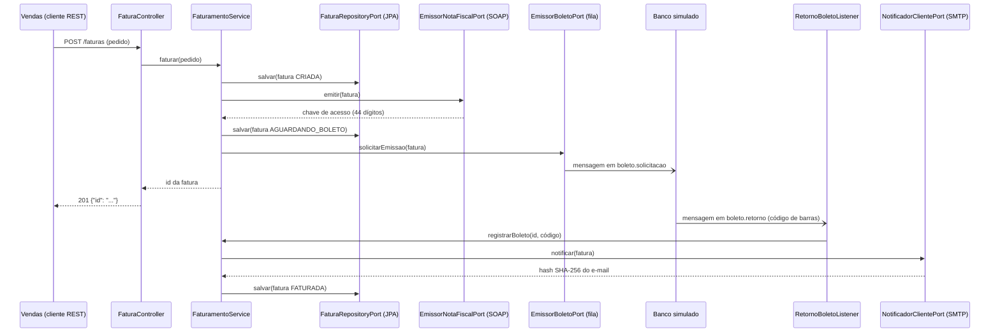

# Aula 7 – Faturando um pedido no hub de integrações

Hub de faturamento em **arquitetura hexagonal (portas e adaptadores)**, feito em Spring Boot 4 / Java 21, como o projeto MVC das aulas anteriores.

## Requisitos atendidos

| Requisito | Como foi feito | Onde |
|---|---|---|
| **RF01** cria e persiste a fatura e devolve o ID ao REST | `Fatura.criar(pedido)` → `FaturaRepositoryPort.salvar` → `POST /faturas` responde `201 {"id": "..."}` | `FaturamentoService.faturar`, `FaturaController`, `FaturaPersistenceAdapter` |
| **RF02** emite o boleto **por fila** | `EmissorBoletoPort` → `BoletoFilaAdapter` publica em `boleto.solicitacao`; o banco simulado responde em `boleto.retorno` | `adapter/out/fila`, `adapter/in/fila`, `simulador/BancoSimulado` |
| RF02 restrição: código de barras guardado na fatura | `RetornoBoletoListener` → `RegistrarBoletoUseCase` → `Fatura.registrarBoleto` (valida 44 dígitos) | `FaturamentoService.registrarBoleto` |
| **RF03** emite a nota fiscal **por SOAP** | `EmissorNotaFiscalPort` → `NotaFiscalSoapAdapter` monta o envelope SOAP e lê `<chNFe>` da resposta | `adapter/out/soap`, `simulador/SefazSoapSimulada` |
| RF03 restrição: chave de 44 dígitos guardada | Chave no layout oficial (cUF+AAMM+CNPJ+modelo+série+número+tpEmis+código+DV mód. 11), validada em `Fatura.registrarNotaFiscal` | `simulador/ChaveAcessoNfe` |
| **RF04** notifica o cliente **por SMTP** | `NotificadorClientePort` → `EmailSmtpAdapter` monta a mensagem e envia ao servidor SMTP simulado | `adapter/out/smtp`, `simulador/ServidorSmtpSimulado` |
| RF04 restrição: hash do conteúdo guardado | SHA-256 do conteúdo do e-mail, validado em `Fatura.registrarNotificacao` | `EmailSmtpAdapter.sha256` |

Todas as portas de saída têm **adaptadores simulados** (nenhum serviço externo é chamado de verdade).

## Arquitetura



- **Domínio e aplicação não dependem de framework.** `Fatura`, `Pedido`, as portas e o `FaturamentoService` são Java puro; o Spring só entra em `config/BeanConfig`, onde as portas recebem os adaptadores.
- **O modelo de banco fica no adaptador** (`FaturaJpaEntity`), e o domínio não tem anotação JPA.
- Trocar um adaptador simulado por um real (RabbitMQ, cliente SOAP da SEFAZ, JavaMail) não muda nada no núcleo.

### Fluxo do faturamento



Status da fatura: `CRIADA` → `AGUARDANDO_BOLETO` → `FATURADA`.

Como o boleto é assíncrono, o `POST` responde logo com o ID e a fatura fica `AGUARDANDO_BOLETO`. O e-mail sai quando o código de barras volta, para o cliente receber a chave da NF-e e o boleto na mesma mensagem. A fatura é salva **antes** de publicar na fila, então o retorno do banco nunca encontra uma versão desatualizada.

## Estrutura

```
hub/src/main/java/br/com/hub/
├── domain/                 # regras de negócio (Java puro)
│   ├── model/              Fatura, Pedido, Cliente, ItemPedido, StatusFatura
│   └── exception/          DomainException, FaturaNaoEncontradaException
├── application/
│   ├── port/in/            FaturarPedidoUseCase, RegistrarBoletoUseCase, ConsultarFaturaUseCase
│   ├── port/out/           FaturaRepositoryPort, EmissorBoletoPort, EmissorNotaFiscalPort, NotificadorClientePort
│   └── service/            FaturamentoService
├── adapter/
│   ├── in/rest/            FaturaController, PedidoRequest, FaturaCriadaResponse, FaturaResponse, RestExceptionHandler
│   ├── in/fila/            RetornoBoletoListener, RetornoBoletoMensagem
│   ├── out/persistencia/   FaturaPersistenceAdapter, FaturaJpaEntity, ItemFaturaEmbeddable, FaturaJpaRepository
│   ├── out/fila/           BoletoFilaAdapter, SolicitacaoBoletoMensagem
│   ├── out/soap/           NotaFiscalSoapAdapter
│   └── out/smtp/           EmailSmtpAdapter
├── infra/fila/             FilaEmMemoria (broker simulado), Filas
├── simulador/              BancoSimulado, SefazSoapSimulada, ServidorSmtpSimulado, ChaveAcessoNfe, CodigoBarrasBoleto
└── config/                 BeanConfig
```

## Como rodar

```bash
cd aula-7/hub
./mvnw spring-boot:run        # Windows: mvnw.cmd spring-boot:run
```

O hub sobe na porta **8081** (a aplicação de vendas da aula 8 usa a 8080).

### Faturar um pedido

```bash
curl -i -X POST http://localhost:8081/faturas \
  -H "Content-Type: application/json" \
  -d '{
        "pedidoId": "PED-1",
        "cliente": { "nome": "Michael Scott", "email": "michael@dundermifflin.com", "documento": "123.456.789-09" },
        "itens": [
          { "descricao": "Papel A4", "quantidade": 10, "valorUnitario": 25.90 },
          { "descricao": "Grampeador", "quantidade": 1, "valorUnitario": 40.00 }
        ]
      }'
```

Resposta (RF01):

```json
{ "id": "7f6ae5b2-4dfa-4627-b352-8408e9229c15" }
```

### Consultar a fatura

```bash
curl http://localhost:8081/faturas/<id>
```

Depois de ~1,5 s (atraso do banco simulado, configurável em `hub.simulador.banco.atraso-ms`):

```json
{
  "id": "7f6ae5b2-...",
  "pedidoId": "PED-1",
  "status": "FATURADA",
  "valorTotal": 299.00,
  "chaveAcessoNotaFiscal": "35261112345678000195550010000000011312453570",
  "codigoBarrasBoleto": "00199163500000299007228428034061700898520664",
  "hashEmail": "aa3db56d7b5e98f8305dfa9467e8f599397e9392f4c579862789c679648d3f92",
  ...
}
```

O log do console mostra o envelope SOAP, as mensagens da fila e o diálogo SMTP simulado.

Erros: `422` para regra de negócio (pedido sem itens, e-mail inválido...), `404` para fatura inexistente e `400` para JSON inválido.

### Testes

```bash
./mvnw test
```

- `FaturamentoServiceTest`: testa o núcleo **sem Spring**, trocando as portas por fakes em memória.
- `GeradoresTest`: formato e dígito verificador da chave da NF-e e do código de barras.
- `HubApplicationTests`: fluxo completo com os adaptadores simulados, até a fatura ficar `FATURADA`.

Console do H2: http://localhost:8081/h2-console (JDBC URL `jdbc:h2:mem:hub`).
