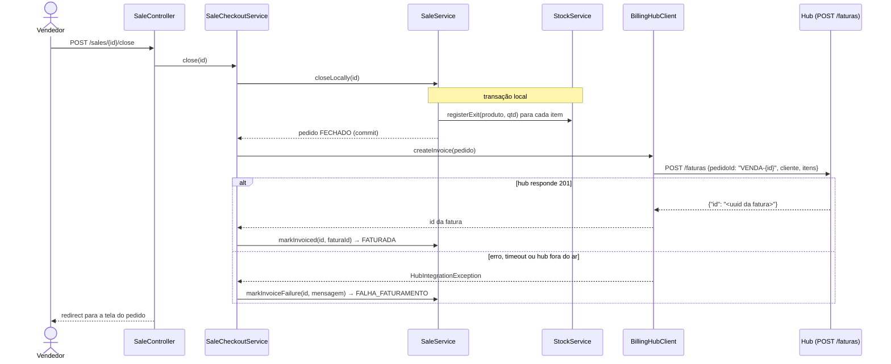

# Aula 8 – Integrando a venda ao hub

## 1. O que foi implementado

A aplicação de vendas (MVC, porta 8080) passou a ter **pedidos de venda** e, ao **fechar um pedido**, faz uma chamada **REST** ao hub de faturamento em arquitetura hexagonal (aula 7, porta 8081) e **guarda o ID da fatura** devolvido.

Peças principais (em `aula-8/mvc`):

| Classe | Papel |
|---|---|
| `model/entity/Sale`, `SaleItem` | Pedido de venda, itens, status (`ABERTA`, `FECHADA`, `FATURADA`, `FALHA_FATURAMENTO`) e `invoiceId` |
| `model/service/SaleService` | Operações locais transacionais: criar, adicionar/remover item, fechar com baixa de estoque, marcar faturado/falha |
| `model/service/SaleCheckoutService` | Orquestra o fechamento: fecha localmente e **depois** chama o hub |
| `model/integration/BillingHubClient` | Cliente REST (`RestClient`) com timeout de conexão e de leitura (`hub.timeout-ms`) |
| `model/integration/HubInvoiceRequest/Response` | Contrato JSON do `POST /faturas` do hub |
| `controller/SaleController` + `view/sales.html`, `view/sale.html` | Telas de vendas |

Decisões tomadas:

- **A transação do banco não fica aberta esperando a rede.** O pedido é fechado e o estoque é baixado numa transação local; só depois do commit o hub é chamado.
- **O pedido sempre envia o mesmo identificador** ao hub (`VENDA-{id}`), inclusive no reenvio.
- Se a chamada falhar, o pedido fica `FALHA_FATURAMENTO` com a mensagem de erro, e a tela oferece **Reenviar ao hub**.

Essas decisões deixam a integração funcionando, mas não eliminam os problemas abaixo.

---

## 2. Problemas que podem acontecer na integração

### Problema 1 – Hub fora do ar ou lento demais

**Como acontece.** O hub está parado (deploy, queda, banco dele indisponível), ou está sobrecarregado e passa do tempo limite. A venda tenta o `POST /faturas` e recebe `Connection refused` ou estoura o timeout.

**O que acontece com o pedido.**

- O pedido **já foi fechado e o estoque já foi baixado**, mas fica **sem fatura** (`FALHA_FATURAMENTO`, `invoiceId` vazio).
- Não existe boleto, nota fiscal nem e-mail para esse pedido, e ele só sai desse estado se alguém clicar em **Reenviar ao hub**.
- Com o hub **lento**, cada fechamento prende uma thread da aplicação de vendas pelo tempo do timeout (5 s). Com muitos vendedores ao mesmo tempo, as threads se esgotam e **a aplicação de vendas inteira fica lenta**, até nas telas que não usam o hub (falha em cascata).

**O que o negócio percebe.**

- O vendedor vê um erro ao fechar a venda e fica sem saber se a venda “valeu”.
- O cliente **não recebe boleto, nota nem e-mail**, então não paga, e a empresa vendeu sem cobrar.
- O estoque diminuiu, mas a venda não aparece no faturamento: **o relatório de vendas não bate com o financeiro**.
- Se ninguém reenviar, a venda fica perdida. Com muitos pedidos nessa situação, alguém precisa conferir um por um.

### Problema 2 – O hub fatura, mas a resposta se perde (fatura duplicada)

**Como acontece.** O hub recebe o pedido, cria a fatura, emite a nota fiscal e coloca o boleto na fila, mas a **resposta não chega** à venda: o tempo de leitura estoura logo antes da resposta, a conexão cai ou um proxy derruba a resposta. Para a venda, a chamada **falhou**, mas no hub ela **deu certo**.

**O que acontece com o pedido.**

- A venda marca o pedido como `FALHA_FATURAMENTO` e **não guarda o ID** da fatura que já existe no hub.
- Quando o vendedor clica em **Reenviar ao hub** (ou quando houver uma retentativa automática), o hub recebe o mesmo pedido de novo e, como hoje não confere se já faturou aquele `pedidoId`, **cria uma segunda fatura**.
- A venda guarda só o ID da segunda fatura. A primeira fica **órfã**: existe no hub, mas nenhum pedido aponta para ela.

**O que o negócio percebe.**

- O cliente recebe **duas notas fiscais, dois boletos e dois e-mails** do mesmo pedido e pode **pagar em dobro**. Isso gera reclamação, estorno e desgaste com o cliente.
- O fiscal precisa **cancelar a NF-e duplicada** dentro do prazo da SEFAZ, e o faturamento do período fica inflado até alguém perceber.
- A conciliação financeira encontra uma fatura que não corresponde a nenhuma venda.

---

## 3. Soluções

### Solução para o Problema 1 – Comunicação assíncrona por fila com *Outbox* (+ *Circuit Breaker*)

**Ideia.** O fechamento da venda não depende do hub estar no ar naquele momento. A venda registra a intenção de faturar e uma mensagem é entregue ao hub quando ele puder recebê-la.

**Onde atua.**

1. **No `SaleService.closeLocally` (lado da venda):** na **mesma transação** que fecha o pedido e baixa o estoque, grava-se um registro numa tabela `outbox` com o JSON do pedido (`pedidoId = VENDA-{id}`). Ou tudo é gravado, ou nada é: não existe mais pedido fechado sem a intenção de faturar registrada.
2. **Num publicador da outbox (novo componente da venda):** um job lê os registros pendentes e publica na fila `faturamento.pedidos` (RabbitMQ, SQS...), com **retentativa e backoff**. Se o hub estiver fora, as mensagens esperam na fila em vez de se perderem.
3. **No hub, um novo adaptador de entrada de fila** consome a mensagem e chama a **mesma** porta `FaturarPedidoUseCase` usada pelo REST. Por ser hexagonal, o núcleo do hub não muda nada, só ganha mais um adaptador de entrada.
4. O ID da fatura volta para a venda por uma fila de retorno (`faturamento.faturas`), e um consumidor na venda chama `markInvoiced`, do mesmo jeito que o hub já faz com o boleto.

Enquanto a integração continuar síncrona, um **Circuit Breaker** no `BillingHubClient` (por exemplo, Resilience4j) complementa: depois de N falhas seguidas o circuito abre e as chamadas falham **na hora**, sem esperar o timeout. Isso protege as threads da aplicação de vendas da falha em cascata.

**Resultado para o negócio.** O vendedor fecha a venda normalmente mesmo com o hub fora do ar. O pedido fica “aguardando faturamento” e é faturado sozinho quando o hub volta. Ninguém precisa reenviar à mão, e o estoque e o faturamento voltam a bater.

### Solução para o Problema 2 – Idempotência no hub (chave = `pedidoId`)

**Ideia.** Faturar o mesmo pedido duas vezes precisa ter o mesmo efeito de faturar uma vez só. A venda **já manda sempre o mesmo `pedidoId`** (`VENDA-{id}`), então ele serve como **chave de idempotência**.

**Onde atua.**

1. **No hub, no `FaturamentoService.faturar` (núcleo da aplicação):** antes de criar a fatura, consulta a porta de saída `FaturaRepositoryPort.buscarPorPedidoId(pedidoId)`. Se já existir fatura para aquele pedido, **devolve o ID existente** e não emite nota, boleto nem e-mail de novo.
2. **No adaptador de persistência do hub:** uma **restrição única** na coluna `fatura.pedido_id` garante a regra mesmo com duas requisições chegando ao mesmo tempo. A segunda falha no banco e o hub responde com a fatura que já existe.
3. **No adaptador REST do hub:** pode responder `200 OK` com o mesmo ID quando a fatura já existia (e `201 Created` quando criou), o que deixa claro para o cliente da API que foi uma repetição.
4. **Na venda (`BillingHubClient`):** com o hub idempotente, a venda pode fazer **retentativa automática com segurança** em caso de timeout, porque reenviar nunca gera cobrança dupla.

**Resultado para o negócio.** Se a resposta se perder, o reenvio só **recupera o ID da fatura que já existe**. O cliente recebe uma nota, um boleto e um e-mail, não paga em dobro, e o fiscal não precisa cancelar notas duplicadas.

> As duas soluções se completam: o *Outbox* com fila garante **pelo menos uma** entrega do pedido ao hub, e a idempotência garante que essa entrega, mesmo repetida, gere **exatamente uma** fatura.

---

## 4. Como testar a integração

1. Suba o hub: `cd aula-7/hub && ./mvnw spring-boot:run` (porta 8081).
2. Suba a venda: `cd aula-8/mvc && ./mvnw spring-boot:run` (porta 8080).
3. Em **Produtos**, cadastre um produto. Em **Estoque**, dê entrada nele.
4. Em **Vendas**, abra um pedido (nome, e-mail e um CPF/CNPJ com 11 ou 14 dígitos), adicione itens e clique em **Fechar pedido**.
5. O pedido fica **Faturado** e mostra o ID da fatura, com um link para `GET /faturas/{id}` no hub.

**Reproduzindo o Problema 1:** pare o hub e feche outro pedido. Ele fica **Falha no faturamento** com o estoque já baixado. Suba o hub de novo e use **Reenviar ao hub**.

**Reproduzindo o Problema 2:** coloque um *breakpoint* no `return` do `FaturaController.faturar` do hub, feche um pedido e espere estourar o `hub.timeout-ms` da venda. Solte o breakpoint e clique em **Reenviar ao hub**. O hub terá **duas faturas** para o mesmo `VENDA-{id}`.
